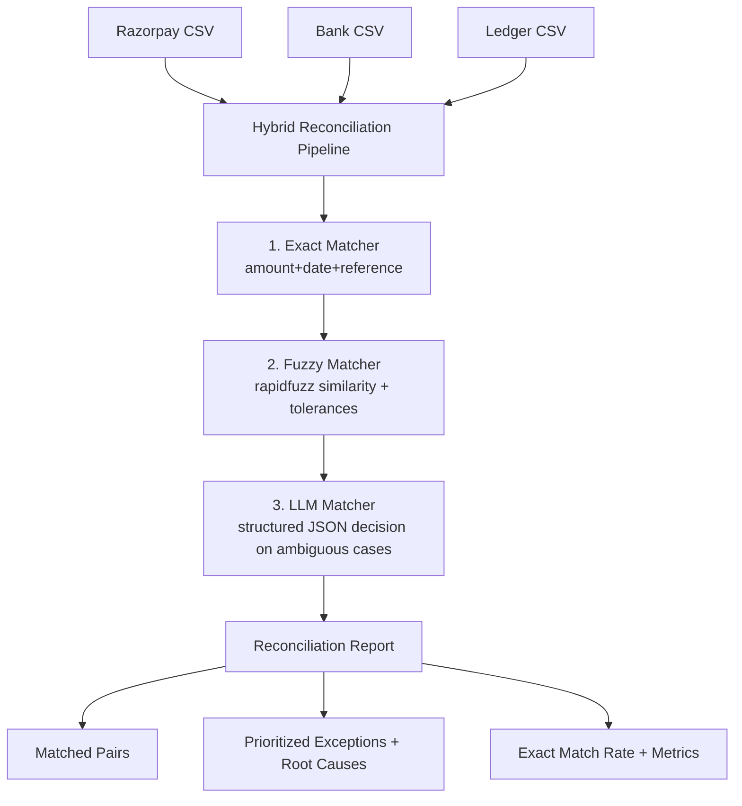

# LedgerMatch AI

LedgerMatch AI is a multi-source reconciliation starter project for **Razorpay AI Buildathon 2026 (Track 4: AI Finance Controller)**.

It reconciles transactions across:
- Razorpay Settlements
- Bank Statement
- Internal Ledger

on a **100+ record synthetic batch**, and reports:
- Exact match rate
- Matched pairs
- Honest prioritized exception list with root causes

## Project Structure

```text
.
├── app.py
├── requirements.txt
├── .env.example
├── data/
│   ├── generate_synthetic_data.py
│   ├── razorpay.csv
│   ├── bank.csv
│   └── ledger.csv
├── src/
│   ├── matcher/
│   │   ├── exact_matcher.py
│   │   ├── fuzzy_matcher.py
│   │   ├── llm_matcher.py
│   │   └── pipeline.py
│   ├── agent/
│   │   └── reconciliation_agent.py
│   ├── models/
│   │   └── transactions.py
│   └── evaluation/
│       └── run_evaluation.py
└── tests/
    ├── test_generator.py
    └── test_matcher_pipeline.py
```

## Architecture



## Features

### 1) Synthetic Data Generator (`data/generate_synthetic_data.py`)
Generates realistic noisy data with:
- fee leakage
- date drifts
- missing references
- hard negatives
- unmatched orphans

### 2) Hybrid Matching Pipeline (`src/matcher/`)
- **Exact pass**: deterministic exact key matching first
- **Fuzzy pass**: rapidfuzz-based similarity + amount/date tolerances
- **LLM pass**: only for unresolved ambiguous candidates; returns structured JSON-compatible decisions

### 3) Evaluation (`src/evaluation/run_evaluation.py`)
Runs full-batch reconciliation and prints:
- total records
- matched records
- exact match rate
- method split (exact/fuzzy/llm)
- matched pair list
- prioritized exceptions with root causes

### 4) Streamlit UI (`app.py`)
- use sample CSVs from `data/` or upload custom files
- run reconciliation
- inspect metrics, matched pairs, and exceptions

## Setup & Run

```bash
pip install -r requirements.txt
python data/generate_synthetic_data.py --records 120 --seed 42 --out data
python -m src.evaluation.run_evaluation --data-dir data
streamlit run app.py
```

## Evaluation Snapshot (sample run)

Using generated batch (`records=120`, `seed=42`):
- **Matched Records**: 90
- **Exact Match Rate**: 41.67%
- **Method Split**: exact=50, fuzzy=30, llm=10

Exceptions are prioritized and include root-cause hints such as:
- probable fee leakage or settlement deductions
- settlement timing drift
- hard negative / ledger posting error
- missing reference and metadata quality gaps

## Notes for Extension

- Replace heuristic LLM fallback by setting `OPENAI_API_KEY` in `.env`.
- Add richer domain features (UTR extraction, narration embeddings, account-level constraints).
- Extend evaluation to include precision/recall against labeled ground truth.
